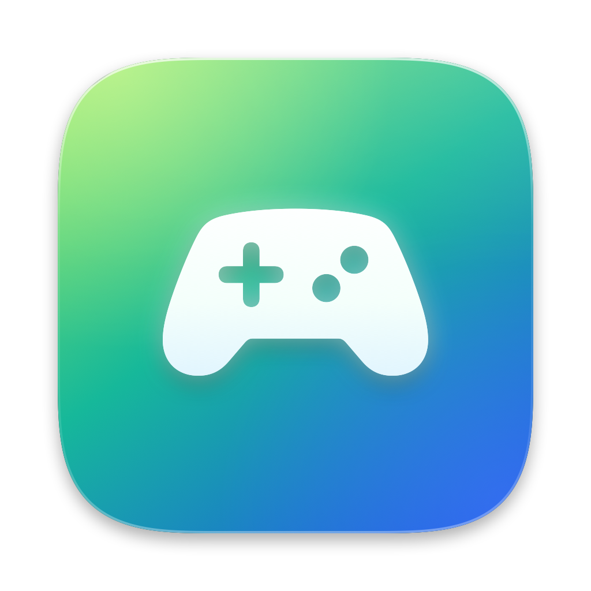
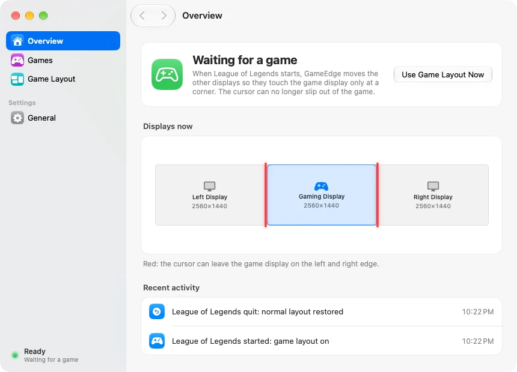
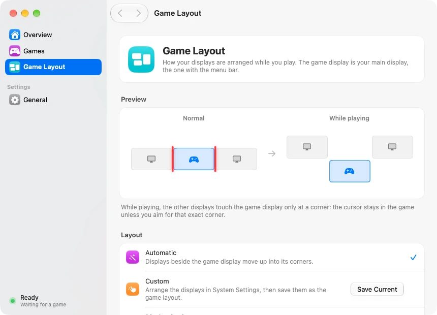
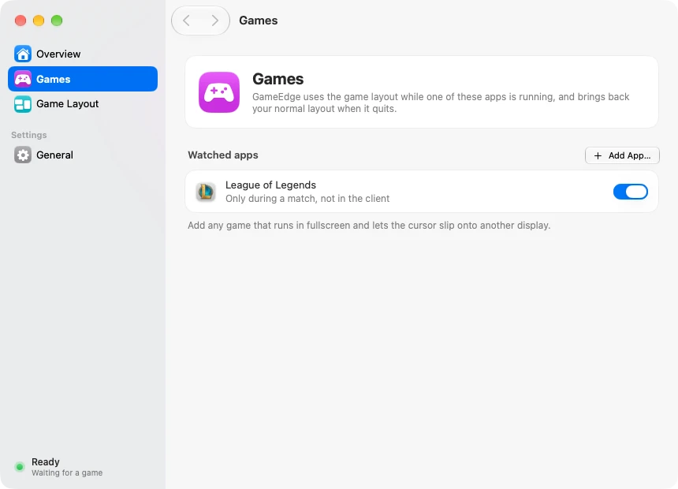

<p align="center">
  <a href="https://github.com/IGOLz/GameEdge/releases/latest"></a>
  
  
  <a href="LICENSE"></a>
</p>

<p align="center">
  
</p>
<h1 align="center">GameEdge</h1>
<h3 align="center">Keeps the cursor inside fullscreen games on Macs with more than one display</h3>
<br/>

<p align="center">
  
</p>

<p align="center">
  <a href="https://github.com/IGOLz/GameEdge/releases/latest"><b>Download</b></a> ·
  <a href="#features">Features</a> ·
  <a href="#screenshots">Screenshots</a> ·
  <a href="#build-from-source">Build</a> ·
  <a href="#contributing">Contributing</a>
</p>

> [!NOTE]
> GameEdge is an independent open-source project and is **not affiliated with Riot Games**. It never touches the game: it only changes how macOS arranges your displays.

## Why

On a Mac with more than one display, some fullscreen games can't hold on to the cursor. In League of Legends, pushing the mouse against the edge that borders another display makes the cursor slip a few pixels onto it: the game's cursor and the macOS arrow flicker back and forth, and clicks can land outside the game.

Cursor-locking apps pull the cursor back *after* it has left, which causes that same flicker. GameEdge removes the shared edge instead: while you play, the other displays touch the game display only at a corner, so its edges become solid walls. When the game quits, your normal arrangement comes back.

## Install

With [Homebrew](https://brew.sh), from the [IGOLz tap](https://github.com/IGOLz/homebrew-tap):

```sh
brew install --cask igolz/tap/gameedge
```

If Homebrew asks you to trust the cask, run `brew trust --cask igolz/tap/gameedge`, then repeat the install command.

Or install manually:

1. Download **GameEdge-x.y.z.dmg** from the [latest release](https://github.com/IGOLz/GameEdge/releases/latest).
2. Open it and drag **GameEdge** to Applications.
3. Open GameEdge. It lives in the menu bar (🎮) and opens at login.

The display layout, ⌥Tab and the rest need no permissions. **Full resolution in Windowed mode** asks once for **Accessibility** (to move the game window) and **Screen Recording** (to show it); without them the game simply stays in its window. The app is signed with a Developer ID and notarized by Apple, so it opens without Gatekeeper warnings. It updates itself: it looks for a new version at launch and once a day, and asks before installing it. Choose **Check for Updates…** in the menu bar, or turn on automatic installs in **General › Updates**.

**Requirements:** macOS 14 Sonoma or later, Apple silicon or Intel. On macOS 14 and 15 everything works the same; buttons use the standard style instead of Liquid Glass, which needs macOS 26.

To update through Homebrew instead, run `brew update` followed by `brew upgrade --cask --greedy igolz/tap/gameedge`. To uninstall, quit GameEdge and run `brew uninstall --cask igolz/tap/gameedge` (add `--zap` to also remove its preferences and log).

## Features

- **Full resolution in Windowed mode** (the recommended way to play): set League of Legends to *Windowed* at your display's resolution. GameEdge runs the game on an invisible extra display a little taller than yours, so it renders at full resolution, and shows its picture live on the main display without the title bar: a true 2560×1440, 16:9 picture that, unlike *Borderless*, **stays visible when you switch apps**. While you play the cursor lives on that invisible display, which touches the others only at a corner, so it can't slip out; when you leave the game it comes back to the same point of the main display, and clicking the picture takes you back. The picture adds about one frame of delay.
- **Automatic**: when a League of Legends match starts, the displays beside the game display move up into its corners. When the match ends, they go back. The client and lobby don't count, only the match.
- **⌘Tab works like on Windows**: switch to another app and the displays go back side by side, so the cursor moves freely while the game keeps running. Return to the game and its layout comes back, with the cursor on the game display.
- **⌥Tab works like ⌘Tab** while a game runs, like Alt+Tab on Windows: from the game to the app you used last, and back.
- **Menu bar and Dock hidden** while a game runs, and given back afterwards exactly as they were. In plain Windowed mode, black bands cover the window's title bar.
- **No giant pointer**: moving the mouse fast in a game no longer triggers macOS *Shake mouse pointer to locate*. GameEdge turns it off while you play and back on afterwards, even after a crash.
- **Any game**: add other apps in **Games**. GameEdge recognises them even when their launcher starts them outside Launch Services.
- **Custom layout**: arrange the displays in System Settings › Displays the way you want to play, then **Save Current Arrangement**.
- **Safe**: the game layout is never saved to disk, so logging out or restarting always brings back your normal arrangement. If GameEdge quits or crashes during a game, it restores the layout the next time it runs.
- **Manual mode**: **Use Game Layout Now** from the menu bar, for a game GameEdge doesn't watch.
- **Live preview** of your displays, with the edges where the cursor can still escape drawn in red.

The game display is your main display, the one with the menu bar. GameEdge never touches the game itself: no injection, no memory access, no changed files, so it's compatible with anti-cheat systems such as Riot Vanguard.

## Screenshots

<p align="center">
  
  
</p>

## Privacy

No analytics, no tracking, no account. GameEdge connects to the internet only to **check for updates** on GitHub (`github.com/IGOLz/GameEdge/releases`), at launch and once a day unless you turn it off. It reads the list of running processes to notice when a game starts and which app is in front. While a game runs it changes, and then restores exactly as they were, *Shake mouse pointer to locate* (Accessibility › Display › Pointer) and the automatic hiding of the menu bar and the Dock. With full resolution in Windowed mode it captures the game window with ScreenCaptureKit only to draw it on your main display: nothing is recorded, saved or sent anywhere. It keeps a log of layout changes in `~/Library/Logs/GameEdge.log`. Settings are stored in the app's preferences.

## Build from source

You need Xcode 26 or later and [XcodeGen](https://github.com/yonaskolb/XcodeGen). The app builds with the macOS 26 SDK and runs on macOS 14 or later; APIs newer than macOS 14 are wrapped in `#available` checks in `App/Sources/UI/Compat.swift`.

```sh
brew install xcodegen
git clone https://github.com/IGOLz/GameEdge.git
cd GameEdge
./scripts/install.sh          # builds and installs /Applications/GameEdge.app
```

<details>
<summary><b>Development</b></summary>

`./scripts/dev-app.sh` builds the Debug configuration as a separate app, **GameEdge Dev** (`dev.igol.GameEdge.Dev`, DEV icon, its own preferences and login item, no self-updates), and installs it next to the regular app. Quit GameEdge while you test game detection with the Dev app, or both will move the displays.

`./scripts/screenshots.sh` captures every page of the Dev app in light and dark with sample displays (`GAMEEDGE_DEBUG_SAMPLE=1`), without touching the real ones.

| Path | Contents |
| --- | --- |
| `App/Sources/App` | Launch, menu bar, main window, updates |
| `App/Sources/Core` | Display geometry and arrangement (`DisplayLayout.swift`), game detection, layout switching, settings |
| `App/Sources/UI` | Main window pages and the design system |
| `Tests/` | Layout, frame delivery, Homebrew and release automation checks; optional live latency probe |
| `scripts/` | Dev app, install, release, DMG, Homebrew, icon and screenshot scripts |
| `docs/` | [Updates](docs/Updates.md), [release issues](docs/ReleaseIssues.md), and [latency investigation](docs/Latency.html) |

```sh
swiftc -parse-as-library App/Sources/Core/DisplayLayout.swift Tests/LayoutChecks.swift -o build/layout-checks && build/layout-checks
swiftc -O -parse-as-library App/Sources/Core/LatestFrame.swift Tests/LatestFrameChecks.swift -o build/frame-checks && build/frame-checks
```

Frame delivery keeps only the latest pending image when the UI is busy. Capture startup is serialized, and callbacks from an old session cannot update a new one. The capture surface pool contains five buffers so retaining the displayed samples does not starve the producer; it is not a five-frame playback queue. Capture follows the source display's native cadence, including ProMotion.

These changes prevent avoidable backlog; they do **not** eliminate capture and compositor latency. `callback-to-commit` in the local log measures only GameEdge's delivery work, not onscreen presentation or mouse-to-photon latency. `superseded` counts pending samples replaced under backpressure, not all frames lost anywhere in the pipeline.

This branch is an experiment, not a released latency fix. The live comparisons did not demonstrate an improvement, and the installed application was restored to 1.3.0. See the [measurements and limitations](docs/Latency.html).

For an observational comparison while League and GameEdge are running, with Screen Recording access for the test executable:

```sh
swiftc -O -parse-as-library Tests/MirrorLatencyProbe.swift -o build/mirror-probe
build/mirror-probe build/latency.json 20
python3 Tests/MirrorLatencyAnalyze.py build/latency.json
```

The probe stores sampled RGB fingerprints and WindowServer timestamps locally, not video. Its two observer streams add load and have independent sampling phases. Static or ambiguous images are discarded. These timings are useful for rejecting unsuccessful approaches; use a controlled workload and optical measurement before claiming an end-to-end latency improvement.

</details>

<details>
<summary><b>Releasing</b></summary>

Bump `MARKETING_VERSION` and `CURRENT_PROJECT_VERSION` in `project.yml`, then:

```sh
RELEASE_NOTES=notes.md ./scripts/release.sh   # universal, signed, notarized DMG + ZIP + appcast.xml
./scripts/publish.sh                          # GitHub release: installed apps receive it
```

After each stable release, `publish.sh` updates the [Homebrew tap](https://github.com/IGOLz/homebrew-tap) after verifying the published DMG against `SHA256SUMS.txt`. If that step fails, retry it with `python3 scripts/update-homebrew.py vX.Y.Z`; prereleases never update the tap.

`release.sh` loads machine-local notarization settings from `.release.env`, which Git ignores. Details on the update feed, the signing key and notarization are in [docs/Updates.md](docs/Updates.md). Issues marked `ready-for-release` in the release's milestone are closed automatically when it's published; see [docs/ReleaseIssues.md](docs/ReleaseIssues.md).

</details>

## Contributing

Bug reports, ideas and pull requests are welcome: open an [issue](https://github.com/IGOLz/GameEdge/issues) or a PR. Reference issues with `Refs #N` rather than `Fixes #N`: an issue is closed when its fix ships in a stable release.

## Acknowledgements

- [Sparkle](https://sparkle-project.org), for in-app updates.
- [XcodeGen](https://github.com/yonaskolb/XcodeGen), for the Xcode project.

## License

GameEdge is released under the [MIT License](LICENSE).
